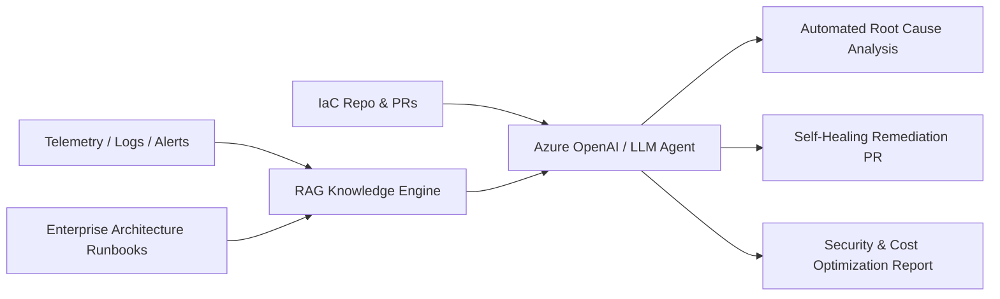
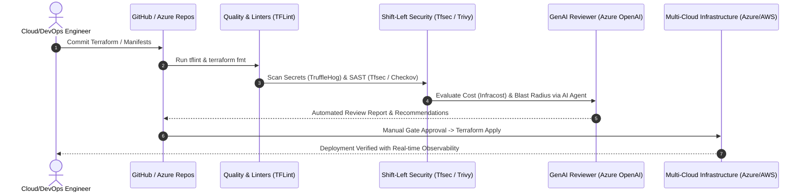

<div align="center">

# ☁️ Jivesh Ranjan Tiwari
### **Principal Cloud Solutions Architect | DevSecOps Leader | Generative AI & AIOps Practitioner**

[](https://git.io/typing-svg)

<p align="center">
  <a href="https://linkedin.com/in/jiveshranjantiwari"></a>
  <a href="mailto:jiveshranjantiwari7@gmail.com"></a>
  <a href="https://github.com/jiveshranjantiwari"></a>
  <a href="#-certifications"></a>
</p>

---

### 🌐 Quick Navigation
[**Executive Profile**](#-executive-profile) • [**Core Competencies**](#-core-competencies--impact) • [**Generative AI & AIOps**](#-generative-ai-rag--agentic-aiops) • [**Architecture Blueprints**](#-enterprise-architecture-blueprints) • [**Tech Stack**](#-enterprise-tech-stack) • [**Certifications**](#-certifications) • [**Connect**](#-connect--collaborate)

---

</div>

## 📌 Executive Profile

Results-driven **Principal Cloud Solutions Architect & DevSecOps Leader** with **13+ years of IT excellence** (including **12+ years of enterprise multi-cloud design, implementation, and optimization**). Specializing in **Microsoft Azure**, **AWS**, and **GCP**, with deep expertise in architecting resilient, compliant, and cost-efficient cloud foundations for Global Enterprises.

A pioneer in bridging **Cloud Infrastructure, Zero-Trust Security, and Generative AI**, integrating **Azure OpenAI, Retrieval-Augmented Generation (RAG), Autonomous AI Agents (LangChain / MCG / Copilot)** into DevOps delivery pipelines to accelerate developer productivity, automate root-cause remediation, and enable self-healing cloud ecosystems.

```
┌───────────────────────────────────────────────────────────────────────────────────────────────────────┐
│                                  🏆 KEY VALUE METRICS & IMPACT                                        │
├───────────────────────────────────┬───────────────────────────────────┬───────────────────────────────┤
│ 🚀 100+ Enterprise Workloads      │ 💰 28%+ Cloud Spend Reduction     │ 🛡️ 100% Shift-Left Security   │
│ Migrated with zero downtime & CAF │ Achieved via FinOps, Infracost,   │ Enforced across CI/CD with    │
│ enterprise landing zone compliance│ OpenCost & automated rightsizing  │ Tfsec, Trivy, TruffleHog & PIM│
└───────────────────────────────────┴───────────────────────────────────┴───────────────────────────────┘
```

---

## 🎯 Core Competencies & Strategic Impact

<table>
  <tr>
    <td width="50%" valign="top">
      <h3>🏛️ Enterprise Architecture & Governance</h3>
      <ul>
        <li><b>Cloud Adoption Framework (CAF):</b> End-to-end design of Hub-and-Spoke virtual networks, Entra ID tenant hierarchy, and workload landing zones.</li>
        <li><b>Infrastructure as Code (IaC):</b> Reusable, modular Terraform suites governed by <code>tflint</code>, <code>tfsec</code>, <code>Super-Linter</code>, and automated drift detection.</li>
        <li><b>Multi-Cloud Mastery:</b> Primary expertise in Microsoft Azure with solid operational architecture across AWS and GCP.</li>
        <li><b>High Availability & Resiliency:</b> Disaster Recovery blueprints (RTO &lt; 15 mins, RPO &lt; 5 mins) using ASR, VMSS, GRS/ZRS, and multi-region failover.</li>
      </ul>
    </td>
    <td width="50%" valign="top">
      <h3>🔐 DevSecOps & Zero-Trust Posture</h3>
      <ul>
        <li><b>Shift-Left Security:</b> Integration of SAST, DAST, secret scanning (TruffleHog), and container image vulnerability assessments (Trivy, SonarQube).</li>
        <li><b>Identity & Access Governance:</b> Zero-Trust identity perimeter using Microsoft Entra ID, Conditional Access, and Privileged Identity Management (PIM JIT).</li>
        <li><b>Automated Policy Enforcement:</b> Enterprise guardrails via Azure Policy, CIS Azure Benchmark, MCSB, and automated compliance auditing.</li>
        <li><b>Kubernetes Hardening:</b> Production Azure Kubernetes Service (AKS) clusters with private API servers, Pod Security Policies, and mTLS Service Mesh.</li>
      </ul>
    </td>
  </tr>
  <tr>
    <td width="50%" valign="top">
      <h3>🤖 Generative AI, RAG & Intelligent Ops</h3>
      <ul>
        <li><b>LLM & GenAI Pipelines:</b> Enterprise AI implementations using Azure OpenAI, LangChain, and vector databases for autonomous cloud troubleshooting.</li>
        <li><b>Autonomous AI Agents:</b> Architecting Multi-Agent Systems & Model Context Governance (MCG) to execute IaC reviews and deployment triage.</li>
        <li><b>Retrieval-Augmented Generation (RAG):</b> Building enterprise knowledge bases over architecture documentation, runbooks, and cloud telemetry.</li>
        <li><b>Developer Velocity:</b> Implementing GitHub Copilot enterprise rollouts, prompt engineering frameworks, and AI-assisted CI/CD pipelines.</li>
      </ul>
    </td>
    <td width="50%" valign="top">
      <h3>📈 FinOps, Observability & Leadership</h3>
      <ul>
        <li><b>Cloud Financial Management (FinOps):</b> Eliminating compute waste, implementing Azure Savings Plans/RIs, and continuous cost estimation with Infracost.</li>
        <li><b>Full-Stack Observability:</b> Centralized Log Analytics, Azure Monitor Agent (AMA), Prometheus, Grafana dashboards, and PagerDuty alert routing.</li>
        <li><b>Enterprise Migration Leadership:</b> Leading cross-functional engineering teams, executing discovery-to-hypercare cutover windows for 100+ applications.</li>
        <li><b>Vendor & Stakeholder Management:</b> RFP/RFI proposals, SOW definitions, technical evaluation scoring matrices, and RACI governance.</li>
      </ul>
    </td>
  </tr>
</table>

---

## 🤖 Generative AI, RAG & Agentic AIOps

Modern cloud architecture demands intelligence at its core. I design and implement **Enterprise Generative AI & Autonomous Operations** that elevate standard DevOps into an AI-driven, self-healing ecosystem:



* **🧠 Azure OpenAI & LangChain Orchestration:** Developing intelligent copilots that query live infrastructure states, diagnose container crash loops, and summarize complex Azure Monitor telemetry.
* **📚 Retrieval-Augmented Generation (RAG):** Indexing enterprise architectural decision records (ADRs), compliance mandates, and internal runbooks into high-performance vector stores for instantaneous contextual problem resolution.
* **🤖 Autonomous DevOps Agents (MCG):** Multi-model context-aware agents that analyze Terraform diffs, predict deployment blast radius, assess security vulnerabilities, and propose optimized configuration changes before hitting production.
* **⚡ Prompt Engineering & Tool Calling:** Fine-tuned system prompts and function-calling schemas that convert natural language requests into validated Terraform modules and GitHub Actions workflows.

---

## 🏛️ Enterprise Architecture Blueprints

### 1. Enterprise Hub-and-Spoke Landing Zone (Zero-Trust)

```
                            [ On-Premises Datacenter ]
                                        │
                         (ExpressRoute / S2S VPN Gateway)
                                        ▼
    ┌────────────────────────────────────────────────────────────────────────┐
    │                    HUB VNet (Central Connectivity)                     │
    │  ┌─────────────────────────┐  ┌─────────────────┐  ┌────────────────┐  │
    │  │ Azure Firewall Premium  │  │  GatewaySubnet  │  │ Private DNS   │  │
    │  │ (TLS Deep Inspection)   │  │  (VPN / ER GW)  │  │ Zones (Hub)    │  │
    │  └────────────┬────────────┘  └─────────────────┘  └────────────────┘  │
    └───────────────┼────────────────────────────────────────────────────────┘
                    │ (VNet Peering + UDR: 0.0.0.0/0 -> Firewall Virtual Appliance)
          ┌─────────┴───────────────────────────────┐
          ▼                                         ▼
┌─────────────────────────────────┐       ┌──────────────────────────────────┐
│  Spoke 1: Workload VNet (Prod)  │       │  Spoke 2: Shared Services VNet   │
│  - App Subnet (AKS / VMSS)      │       │  - Self-Hosted CI/CD Runners     │
│  - DB Subnet (Private Endpoints)│       │  - Azure Bastion Host            │
│  - NSG + Micro-segmentation     │       │  - Security & Vulnerability Tools│
└─────────────────────────────────┘       └──────────────────────────────────┘
```

### 2. Hardened Shift-Left DevSecOps CI/CD Pipeline



---

## 🛠️ Enterprise Tech Stack

<div align="center">

### ☁️ Cloud Platforms & Network Infrastructure


-326CE5?style=for-the-badge&logo=kubernetes&logoColor=white)


### 🏗️ Infrastructure as Code & Automation


### 🤖 Generative AI, AIOps & Intelligent Systems


### 🔐 DevSecOps, Identity & Security Posture


### 🐳 Containers, Orchestration & Service Mesh


### 🔄 CI/CD Pipelines & Source Control


### 📊 Observability, FinOps & SRE


### 💻 Languages & System Scripting


</div>

---

## 🏆 Certifications

<div align="center">

| Credential | Issuer | Credential Validation |
| :--- | :---: | :---: |
| **AWS Certified Solutions Architect – Associate (SAA-C03)** | Amazon Web Services | `Verified Solutions Architect` |
| **Microsoft Certified: Azure Administrator Associate (AZ-104)** | Microsoft | `Verified Azure Administrator` |
| **Aviatrix Multi-Cloud Network Associate (MCNA)** | Aviatrix Systems | `Verified Multi-Cloud Network Architect` |

</div>

---

## 📦 Featured Production Architectures & Modules

<table width="100%">
  <tr>
    <td width="50%">
      <h3>🏛️ <a href="https://github.com/jiveshranjantiwari">Enterprise Azure CAF Landing Zone</a></h3>
      <p>Production-ready Terraform framework provisioning enterprise Management Groups, Subscription boundaries, Hub-and-Spoke connectivity, Azure Firewall, and CIS-hardened Azure Policies.</p>
      <p>
        
        
        
      </p>
    </td>
    <td width="50%">
      <h3>🔐 <a href="https://github.com/jiveshranjantiwari">Zero-Trust DevSecOps Accelerator</a></h3>
      <p>Reusable GitHub Actions & Azure DevOps pipeline templates integrating <b>Tfsec, Trivy, TruffleHog, and Super-Linter</b> with automated security gates and drift detection triggers.</p>
      <p>
        
        
        
      </p>
    </td>
  </tr>
  <tr>
    <td width="50%">
      <h3>🤖 <a href="https://github.com/jiveshranjantiwari">AIOps Autonomous Cloud Incident Resolver</a></h3>
      <p>AI agent built with <b>Azure OpenAI, LangChain & RAG</b> that digests Azure Monitor alerts, correlates distributed Kubernetes logs, and creates automated pull requests to heal infrastructure.</p>
      <p>
        
        
        
      </p>
    </td>
    <td width="50%">
      <h3>☸️ <a href="https://github.com/jiveshranjantiwari">Production AKS Observability & SRE Stack</a></h3>
      <p>Hardened Azure Kubernetes Service cluster provisioning with private endpoints, internal ingress controller, Helm-managed Prometheus-Stack, Grafana dashboards, and OpenCost FinOps tracking.</p>
      <p>
        
        
        
      </p>
    </td>
  </tr>
</table>

---

## 📊 Live GitHub Activity & Engineering Metrics

<div align="center">


<br/>


</div>

---

## 🤝 Leadership & Vendor Delivery Framework

Senior leadership demands the ability to steer technology partners, lead technical estimations, and execute zero-defect deliveries:

```
[ RFI / RFP Solicitation ]
            │
            ▼
[ Technical Evaluation Matrix (Security, Scalability, Cost) ]
            │
            ▼
[ Statement of Work (SOW) & RACI Governance ]
            │
            ▼
[ Sprint Execution & Continuous Architecture Review ]
            │
            ▼
[ Formal Acceptance Sign-Off & Knowledge Transfer (Runbooks) ]
```

* **RACI Accountability:** Clear role delegation ensuring every workload has defined **R**esponsible engineers, a single **A**ccountable architect, **C**onsulted domain experts, and **I**nformed executive stakeholders.
* **Architecture Compliance Review (ACR):** Periodic gate check verifying zero deviation from security baselines, FinOps budgets, and disaster recovery SLA commitments.

---

## ⚡ Guiding Motto

> ### *"Automate fearlessly • Secure proactively • Scale infinitely • Innovate relentlessly"*

---

## 🌐 Connect & Collaborate

Are you looking to modernize your enterprise cloud estate, establish zero-trust DevSecOps pipelines, or integrate cutting-edge Generative AI into your cloud operations? Let's connect!

<div align="center">

<a href="https://linkedin.com/in/jiveshranjantiwari">
  
</a>
&nbsp;&nbsp;
<a href="mailto:jiveshranjantiwari7@gmail.com">
  
</a>
&nbsp;&nbsp;
<a href="https://github.com/jiveshranjantiwari">
  
</a>

<br/><br/>

⭐ **If you find value in my architectural blueprints and open-source contributions, please consider starring my repositories!**

</div>
